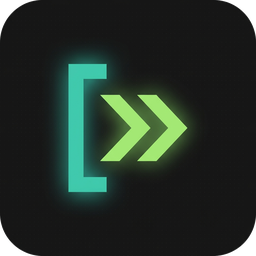
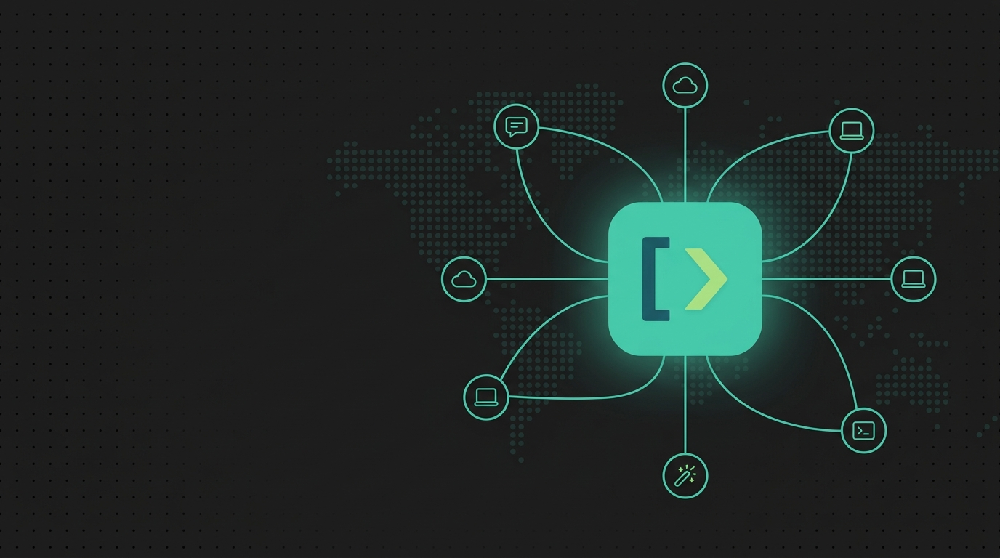
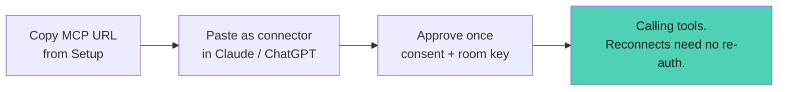
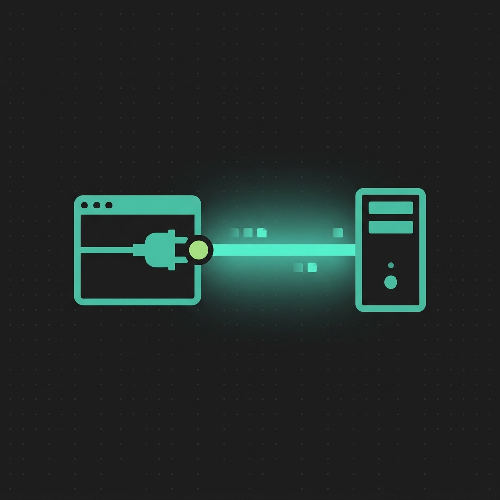
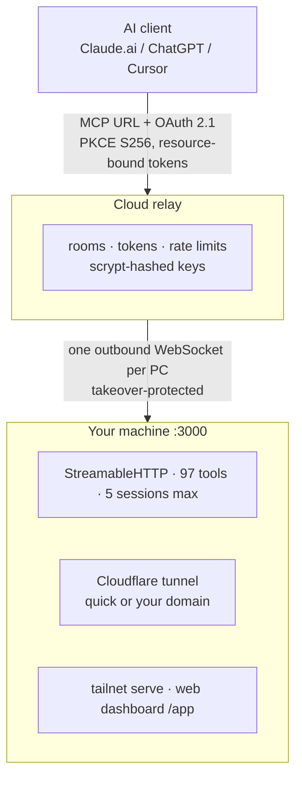

<div align="center">



# Solisk PC Control MCP

### Give trusted AI clients secure control of your Windows PC.

[](https://github.com/Kyzenkms/solisk-pc-mcp/releases)
[](LICENSE)
[](#-os-support)
[](https://modelcontextprotocol.io)
[](#-security-model)

*Desktop control room · Headless CLI · Cloud relay · Custom domains · Tailnet*

[Download MSI](#-install) ·
[60-second connect](#-connect-an-ai-in-60-seconds) ·
[OS support](#-os-support) ·
[Self-host](#-self-host-the-relay) ·
[FAQ](#-faq)

</div>



---

> **One product, three faces, one runtime per machine.** An AI connects with your MCP URL, approves once, and calls tools. You watch every session, toggle every path, revoke anything.

<details open>
<summary><b> Which face do I need?</b></summary>
<br>

| You are… | Use | Get started |
|---|---|---|
| On Windows, want clicks not terminals | **Control room** (Electron GUI) | [Install](#-install) |
| On a VPS / homelab / automation | **CLI** (`solisk`) | `solisk setup` then `solisk doctor` |
| On a phone, tablet, second machine | **Web dashboard** (`/app`) | Local `:3000/app` or tailnet URL, key once, tick *Remember* |

</details>

---

##  Install

<details open>
<summary><b>Windows (MSI first)</b></summary>
<br>

1. Download **`PC Control MCP 1.0.0.msi`** from [Releases](https://github.com/Kyzenkms/solisk-pc-mcp/releases) and run it.
2. Classic `Setup .exe` rides along in the same release. Unsigned build → SmartScreen asks once: *More info → Run anyway*.
3. Headless later? `solisk gui setup --installer <path-to-.msi>` does it from the terminal.

</details>

<details>
<summary><b>From source (contributors)</b></summary>
<br>

```powershell
git clone https://github.com/Kyzenkms/solisk-pc-mcp.git
cd solisk-pc-mcp\desktop-app
npm install
npm run build:unsigned-beta   # NSIS installer (daily path, fast)
node build-msi.js             # MSI (release day only — slow)
```

</details>

---

##  Connect an AI in 60 seconds



> **First connect fails, retry works?** Claude cached a failed discovery. Remove + re-add the connector once — consent then appears directly.

| Connect | Authorize | Control |
|:---:|:---:|:---:|
|  |  |  |

---

##  OS support

| OS | GUI | CLI (`solisk`) | MCP URL clients | Tools |
|:---|:---:|:---:|:---:|---|
| **Windows 10/11 x64** | ✅ full control room | ✅ | ✅ local + relay + tunnel | **97** native |
| **Linux** | ❌ → CLI + web dashboard | ✅ server · stdio · tunnels · Tailscale | ✅ | 45 portable + `shell_exec` |
| **macOS** | ❌ → CLI + web dashboard | ✅ server · stdio | ✅ | 45 portable + `shell_exec` |

Windows-only automation (mouse/keyboard hooks, screenshots, native dialogs) stays off elsewhere; everything portable stays on. Relay, tunnels, OAuth, keys, remembered devices, sessions, update checks — **identical on all three**.

---

##  Highlights

<details open>
<summary><b>Four paths in, four switches</b></summary>
<br>

Hosted relay · Cloudflare tunnel (quick or your domain) · Tailnet · Web dashboard. Each toggles **live** from Setup. The dashboard toggle kills `/app` + `/dashboard` entirely (`404`), not just Tailnet.

</details>

<details>
<summary><b>Sessions counted honestly · Remembered devices · Offline-first</b></summary>
<br>

- One live AI reads `1`. Idle ghosts expire after 10 minutes; every surface (GUI, CLI, API) reads the live count.
- Tick *Remember this device* on the console key gate → 30 days keyless. `solisk devices list` / `solisk devices revoke <id>` from anywhere.
- No internet? The app says so plainly, everything local keeps working, remote redials itself. Errors are sentences, never stack traces.

</details>

<details>
<summary><b>Updates & no-fight guarantee</b></summary>
<br>

- New release → in-app popup with notes + download (skip-a-version supported, mandatory releases can't be skipped).
- CLI and GUI never fight: one runtime per machine. The CLI attaches to a running GUI — borrowing its key transparently — and refuses to boot a second server over it.

</details>

---

##  CLI reference

`solisk` is the short name (`pc-control` works everywhere).

<details open>
<summary><b>Daily commands</b></summary>
<br>

```
solisk dashboard [--no-open]      web console for the running server
solisk doctor [--fix]             11 health checks — 0 failing is the goal
solisk logs [--lines N]           live server log, whichever face owns it
solisk setup                      step-by-step onboarding wizard
solisk backup                     config snapshot for restores
```

</details>

<details>
<summary><b>Access control</b></summary>
<br>

```
solisk config get|set|validate    ports, modes, domains (secrets refused — see rotate-key)
solisk rotate-key                 new owner key, zero-downtime relay rotation
solisk keys list|add|revoke       scoped client keys (fail-closed defaults)
solisk devices list|revoke        remembered browsers (the key-gate cookie)
solisk relay status|retry         room state, redial (reaches the GUI socket too)
```

</details>

<details>
<summary><b>Exposure</b></summary>
<br>

```
solisk tunnel off|quick|custom    + login, create, route, forget, status
solisk tailscale status|serve|off funnel is deliberate and confirmed
solisk gui status|setup           detect install, install from .exe or .msi
```

Every attach command works with zero flags next to a running GUI.

</details>

---

##  Architecture



> One config file, one event bus, one session store. Thin faces (Electron, CLI, web shim) never own state.

---

##  Security model

| # | Guarantee | How |
|:---:|---|---|
| 1 | **Bearer-only** | Owner key, scoped key, OAuth token, or device cookie on every data route. Shells public, data never. |
| 2 | **Zero-trust relay** | Authenticates before forwarding one byte. Takeovers logged + blocked. |
| 3 | **PKCE + exact redirects + bound tokens** | No cross-room token reuse, ever. |
| 4 | **Hashed at rest** | scrypt + unique salts. Secrets never hit logs or disk plaintext. |
| 5 | **Fail closed** | Unknown session → re-init. Offline → local works, remote redials. 300/min relay, 400/min local, 5 sessions, idle expiry. |
| 6 | **Deliberate destruction** | Funnel, turbo, URL regen all confirm first and say what happens. |

Full policy: [SECURITY.md](SECURITY.md) · Found something? [Security advisory](https://github.com/Kyzenkms/solisk-pc-mcp/security/advisories/new), not an issue.

---

##  Self-host the relay

<details open>
<summary><b>One command, Docker or PM2</b></summary>
<br>

```bash
ssh root@YOUR_VPS
bash -c "$(curl -fsSL https://raw.githubusercontent.com/Kyzenkms/solisk-pc-mcp/main/self-hosted-setup/vps/install.sh)"
```

Pick domain type (yours / `sslip.io` testing), then runtime (Docker / PM2). It prints the room + key to paste into the app. Backups, firewall, updates: [self-hosted-setup/README.md](self-hosted-setup/README.md).

</details>

---

##  Verify it

```bash
cd relay-server && node --test test/oauth.test.js   # OAuth regression suite
node test-live.js                                    # end-to-end vs a running server
solisk doctor                                        # this machine — 0 failing is the goal
```

---

##  FAQ

<details open>
<summary><b>SmartScreen warns on install</b></summary>
<br>Unsigned build — <i>More info → Run anyway</i>. An EV certificate ends this; it's budgeted, not done.
</details>

<details>
<summary><b>One AI shows N sessions</b></summary>
<br>Stale IDs from reconnects — they expire after 10 idle minutes. Live count is exact at connect time.
</details>

<details>
<summary><b>CLI says key refused next to a running GUI</b></summary>
<br>It borrows the GUI key automatically and tells you (fingerprint shown). <code>solisk gui status</code> shows both fingerprints.
</details>

<details>
<summary><b>After restart it shows 0 sessions</b></summary>
<br>Correct — sessions live in memory. The moment Claude re-initializes, the count appears. Grants and keys persist; nobody re-authenticates.
</details>

---

<div align="center">

[MIT](LICENSE) — Solisk PC Control MCP · v1.0.0

</div>
