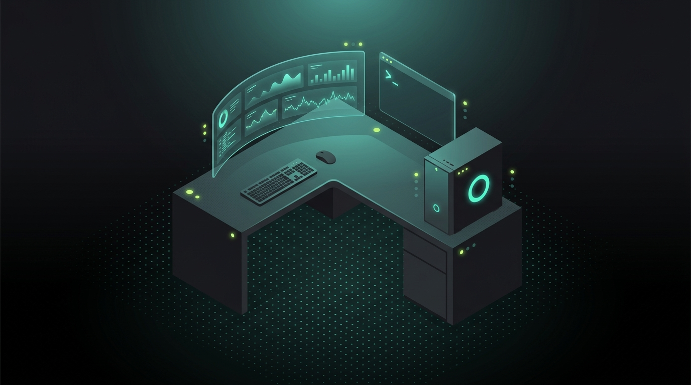
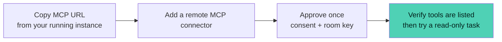
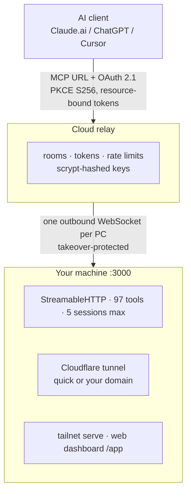

<div align="center">

<picture>
  <source media="(prefers-color-scheme: dark)" srcset="assets/brand/readme/hero-dark.svg">
  
</picture>

[](https://github.com/Kyzenkms/solisk-pc-mcp/releases)
[](https://www.npmjs.com/package/solisk)
[](https://www.npmjs.com/package/solisk)
[](https://github.com/Kyzenkms/solisk-pc-mcp/stargazers)
[](LICENSE)
[](#requirements)
[](#os-support)

[Install](#install) · [Windows GUI](#windows-gui) · [Connect an AI](#connect-an-ai) · [Security](#security-model) · [Self-host](#self-host-the-relay) · [CLI](#cli-reference) · [FAQ](#faq)

</div>

# Let your AI work with files and apps on your PC

**Solisk connects MCP-compatible AI clients to your machine.** Read a project file,
inspect a Git diff, or use Windows desktop tools without building a separate
integration for each app. Start locally; use the hosted relay or run your own
relay when the client needs a remote URL.

- **Local or self-hosted:** the runtime and relay are MIT-licensed and included here.
- **A Windows control room:** manage connections and approve supported shell commands locally.
- **CLI on Windows, Linux and macOS:** capabilities differ by platform; see [OS support](#os-support).

PC access is powerful. Use a test folder first and read the [trust boundaries](#security-model)
before granting shell or desktop access. Approval is not a universal gate for every tool.

## See the first win

Run a complete local workflow before connecting a real project or remote relay:

```bash
node examples/first-win.js
```

The demo uses synthetic data and real MCP stdio calls to read a CSV, write and
verify a Markdown report, then prove a path outside the allowed folder is denied.
No account, model API key, relay or network is required. See [LAUNCH.md](LAUNCH.md)
for the recording script, interactive product film and launch copy.

Open the interactive product film at [`assets/launch/solisk-brand-film.html`](assets/launch/solisk-brand-film.html)
for the visual overview, then run the technical demo to verify the local MCP path.

## Install

```bash
npm install -g solisk      # requires Node 22.5+
solisk setup              # configure identity and approval mode
```

Then choose **one** connection path below. For Windows users who prefer an installer,
skip npm and use the [Windows GUI](#windows-gui).

### Local client on the same machine

For an MCP client that accepts command-based servers, add this entry to its MCP
configuration. The client starts and stops Solisk; don't also start an HTTP server
for this connection.

```json
{
  "mcpServers": {
    "solisk": {
      "command": "solisk",
      "args": ["--mode=stdio"]
    }
  }
}
```

If the client cannot find `solisk`, restart it after installation or configure the
absolute path to the installed command. Stdio uses the permissions of the local
process, not a bearer-key login. It does not open the web dashboard or a relay.

### Hosted or HTTP clients

Start the server and leave this terminal running:

```bash
solisk --mode=http
```

In a **second terminal**, open the control room:

```bash
solisk dashboard
```

Use the MCP URL shown by the running instance for remote clients. For local HTTP,
the default endpoint is `http://127.0.0.1:3000/mcp` and requires authentication.
Use `solisk --mode=http --no-relay` to disable the hosted relay for that run;
also leave Cloudflare and Tailscale exposure off for a local-only setup.

## Windows GUI

<div align="center">
  
</div>

1. Open the [latest release](https://github.com/Kyzenkms/solisk-pc-mcp/releases/latest) and download its **`PC Control MCP Setup … .exe`** asset and `SHA256SUMS.txt`. An MSI is not included in every release.
2. Run it: point-and-click control room, same engine as the CLI.
3. Already have the CLI? `solisk gui setup --installer "<path-to-downloaded-installer.exe>"` installs it silently.
4. On Linux/macOS, `solisk gui` refuses by design and points you to the web dashboard.

> [!WARNING]
> The Windows installer is unsigned and may trigger SmartScreen. Download only from the official release and compare its SHA-256 hash with `SHA256SUMS.txt` before deciding whether to run it. A checksum is not a publisher signature. Older release assets may still carry a `1.0.0` filename; consult the release notes rather than guessing a download URL.

## Connect an AI

For a remote connector, use your instance's URL and complete the client's
authorization flow. Keep the room key out of chat messages and screenshots.
Available connector features depend on the client and account.



<div align="center">

| Connect | Authorize | Control |
|:---:|:---:|:---:|
|  |  |  |

</div>

> [!NOTE]
> If discovery fails, first check that the runtime and selected connection path are online. If a client cached an earlier failed connection, removing and re-adding the connector may help; it is not a substitute for checking the server error.

### Your first successful task

Choose a non-sensitive text file in a folder you have allowed, then ask:

> Use Solisk's `read_file` tool to read the file at the absolute path I provide
> and summarize it in three bullets. Do not run shell commands or change files.

Success means the client lists Solisk's tools, `read_file` returns that file's
contents, and the summary matches. If access is denied, correct the allowed path
or key scope rather than switching to Turbo. Next, try inspecting a Git diff
in a test repository. Desktop automation can wait until this basic flow works.

## Security model

| # | Control | Boundary |
|:---:|---|---|
| 1 | **HTTP authentication** | Owner/scoped keys and OAuth authenticate HTTP clients; remembered device cookies also authorize web-console access. Stdio trusts the process launching it. |
| 2 | **Authenticated relay** | TLS terminates at the relay, which can see forwarded requests and results. There is no client-to-PC end-to-end encryption. |
| 3 | **Relay OAuth** | PKCE S256, redirect checks and resource-bound tokens protect the relay authorization flow. |
| 4 | **Credential storage** | Relay API keys are scrypt-hashed. Local config keys and local OAuth tokens are stored in plaintext files; protect the profile and backups. |
| 5 | **Tool permissions** | Use scoped keys and file-path rules, but do not treat them as an OS sandbox around shell commands or desktop automation. |
| 6 | **Approval and audit** | Approval behavior depends on the tool and runtime. Tool audit records include arguments, which may contain sensitive data. |

Full policy: [SECURITY.md](SECURITY.md) · found something? [Security advisory](https://github.com/Kyzenkms/solisk-pc-mcp/security/advisories/new) — not a public issue.

## Everything, live

| | |
|---|---|
| **Four paths in** | Hosted relay · Cloudflare tunnel (quick or your own domain) · tailnet · web dashboard. Each toggles live; killing the dashboard returns `404` on `/app` — not just tailnet. |
| **Honest sessions** | One live AI reads `1`. Ghost sessions expire after 10 idle minutes; every surface (GUI, CLI, API) reads the live count. |
| **Keys that fit** | Scoped client keys, fail-closed defaults, zero-downtime rotation, 30-day remembered devices. |
| **No-fight runtime** | CLI attaches to a running GUI, borrows its key transparently, and refuses to boot a second server over it. |
| **Updates** | In-app release notes, skip-a-version supported, mandatory releases cannot be skipped. |

## Architecture



> One config file, one event bus, one session store. Thin faces (Electron, CLI, web shim) never own state.

## OS support

| OS | CLI (`solisk`) | Web dashboard (`/app`) | GUI | Tools |
|:---|:---:|:---:|:---:|---|
| **Windows 10/11 x64** | ✅ local + relay + tunnel | ✅ | ✅ full control room | **97** native |
| **Linux** | ✅ server · stdio · tunnels · Tailscale | ✅ | ❌ — `solisk gui` refuses, points to `/app` | Portable tools + `shell_exec` |
| **macOS** | ✅ server · stdio | ✅ | ❌ — same | Portable tools + `shell_exec` + native screenshot/input implementations |

Windows-only implementations stay off elsewhere. macOS includes native screenshot
and input tools that need Screen Recording and Accessibility permissions. Run
`solisk --list-tools` for the actual inventory on your machine. Platform support
does not imply identical tool behavior or security coverage.

### Requirements

- **Node ≥ 22.5** for the CLI.
- Windows 10/11 x64 for the GUI.
- Nothing else — no Docker, no reverse proxy needed for localhost use.

## Self-host the relay

```bash
ssh root@YOUR_VPS
bash -c "$(curl -fsSL https://raw.githubusercontent.com/Kyzenkms/solisk-pc-mcp/main/self-hosted-setup/vps/install.sh)"
```

<details>
<summary><b>What the script does</b></summary>
<br>

Picks your domain type (yours or `sslip.io` for testing), then runtime (Docker or PM2), then prints the room + key to paste into the app. Backups, firewall, updates: [self-hosted-setup/README.md](self-hosted-setup/README.md).

</details>

## CLI reference

`solisk` is the command — `pc-control` remains as a compatibility alias.

<details open>
<summary><b>Daily</b></summary>
<br>

```
solisk dashboard [--no-open]      web console for the running server
solisk doctor [--fix]             11 health checks — 0 failing is the goal
solisk logs [--lines N]           live server log, whichever face owns it
solisk setup                      step-by-step onboarding wizard
solisk backup                     config snapshot for restores
```

</details>

<details>
<summary><b>Access control</b></summary>
<br>

```
solisk config get|set|validate    ports, modes, domains (secrets refused)
solisk rotate-key                 new owner key, zero-downtime rotation
solisk keys list|add|revoke       scoped client keys (fail-closed defaults)
solisk devices list|revoke        remembered browsers
solisk relay status|retry         room state, redial
```

</details>

<details>
<summary><b>Exposure</b></summary>
<br>

```
solisk tunnel off|quick|custom    + login, create, route, forget, status
solisk tailscale status|serve|off funnel is deliberate and confirmed
solisk gui status|setup           detect install, install from .exe or .msi
```

Every attach command works with zero flags next to a running GUI.

</details>

## Verify

```bash
npm ci
npm ci --prefix relay-server
npm test                         # isolated config; unit, HTTP, stdio and relay checks
npm run test:stdio               # registry launch arguments + actual MCP file read
npm run test:package             # extracted npm tarball: dashboard + API auth
```

Run these from the repository root. CI runs the full suite on Windows and stdio
smoke tests on Linux/macOS; release builds depend on those jobs. `npm run test:live`
targets a running server rather than an isolated fixture; use it only deliberately.
For an installed runtime, use `solisk doctor` to inspect local setup.
The packaging test needs `tar` on PATH and reuses the checkout's installed
dependencies; it does not replace a fresh-machine install test.

## FAQ

<details>
<summary><b>One AI shows N sessions</b></summary>
<br>Stale IDs from reconnects — they expire after 10 idle minutes. The live count is exact at connect time.
</details>

<details>
<summary><b>CLI says key refused next to a running GUI</b></summary>
<br>It borrows the GUI key automatically and tells you (fingerprint shown). <code>solisk gui status</code> shows both fingerprints.
</details>

<details>
<summary><b>After restart it shows 0 sessions</b></summary>
<br>Correct — sessions live in memory. The moment the client re-initializes, the count appears. Grants and keys persist; nobody re-authenticates.
</details>

<details>
<summary><b>Can I run the GUI on Linux?</b></summary>
<br>No — the control room is Windows-only by design. On Linux and macOS use the CLI plus the web dashboard at <code>/app</code>, which is the same control room in a browser.
</details>

<div align="center">

<sub>[MIT](LICENSE) · Solisk PC Control MCP · [Releases](https://github.com/Kyzenkms/solisk-pc-mcp/releases) · [solisk.org](https://solisk.org)</sub>

</div>
