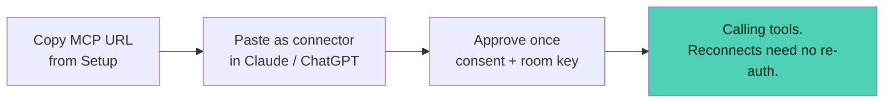
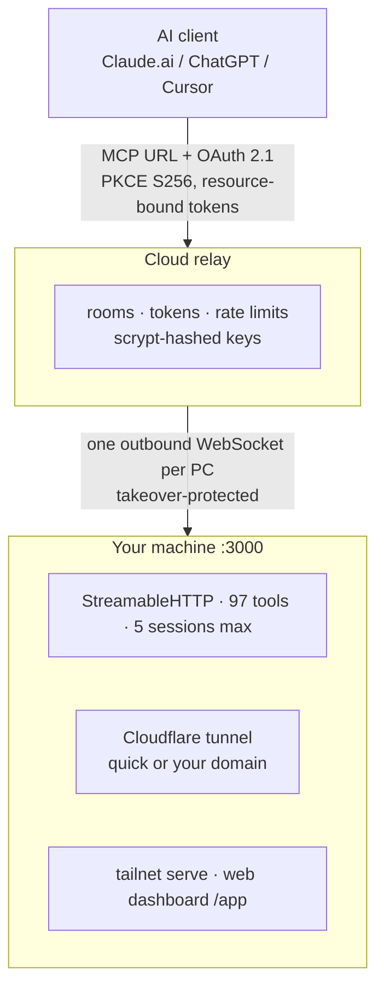

<div align="center">

<picture>
  <source media="(prefers-color-scheme: dark)" srcset="assets/brand/readme/hero-dark.svg">
  
</picture>

[](https://github.com/Kyzenkms/solisk-pc-mcp/releases)
[](https://www.npmjs.com/package/solisk)
[](https://www.npmjs.com/package/solisk)
[](https://github.com/Kyzenkms/solisk-pc-mcp/stargazers)
[](LICENSE)
[](#requirements)
[](#os-support)

[Install](#install) · [Windows GUI](#windows-gui) · [Connect an AI](#connect-an-ai-in-60-seconds) · [Security](#security-model) · [Self-host](#self-host-the-relay) · [CLI](#cli-reference) · [FAQ](#faq)

</div>

> [!TIP]
> **One product, three faces, one runtime per machine.** Connect any MCP client by URL, approve once, call 97 tools — and watch every session, toggle every path, revoke anything. CLI on every OS, desktop control room on Windows, web dashboard (`/app`) anywhere.

## Install

```bash
npm install -g solisk      # Node 22.5+ · or run without installing: npx solisk
solisk setup               # room name, owner key, approval mode — step by step
solisk --mode=http         # MCP server on 127.0.0.1:3000 (default)
solisk dashboard           # web control room at /app
```

Windows, Linux and macOS servers run the same command. Off-Windows serves the 45 portable tools + `shell_exec`; Windows-only automation stays off. The `/app` dashboard is the control room on every OS.

## Windows GUI

<div align="center">
  
</div>

1. Download **`PC Control MCP 1.0.0.msi`** from [Releases](https://github.com/Kyzenkms/solisk-pc-mcp/releases) — the classic `Setup .exe` rides along.
2. Run it: point-and-click control room, same engine as the CLI.
3. Already have the CLI? `solisk gui setup --installer <path-to-.msi>` installs it silently.
4. On Linux/macOS, `solisk gui` refuses by design and points you to the web dashboard.

> [!WARNING]
> The build is unsigned, so SmartScreen asks once: **More info → Run anyway**. An EV certificate ends this; it is budgeted, not done.

## Connect an AI in 60 seconds



<div align="center">

| Connect | Authorize | Control |
|:---:|:---:|:---:|
|  |  |  |

</div>

> [!NOTE]
> First connect fails but a retry works? Claude cached a failed discovery — remove and re-add the connector once, consent then appears directly.

## Security model

| # | Guarantee | How |
|:---:|---|---|
| 1 | **Bearer-only** | Owner key, scoped key, OAuth token, or device cookie on every data route. Shells public, data never. |
| 2 | **Zero-trust relay** | Authenticates before forwarding one byte. Takeovers logged and blocked. |
| 3 | **PKCE + exact redirects + bound tokens** | No cross-room token reuse, ever. |
| 4 | **Hashed at rest** | scrypt with unique salts. Secrets never hit logs or disk plaintext. |
| 5 | **Fail closed** | Unknown session → re-init. Offline → local keeps working, remote redials. 300/min relay, 400/min local, 5 sessions, idle expiry. |
| 6 | **Deliberate destruction** | Funnel, turbo, URL regen all confirm first and state what happens. |

Full policy: [SECURITY.md](SECURITY.md) · found something? [Security advisory](https://github.com/Kyzenkms/solisk-pc-mcp/security/advisories/new) — not a public issue.

## Everything, live

| | |
|---|---|
| **Four paths in** | Hosted relay · Cloudflare tunnel (quick or your own domain) · tailnet · web dashboard. Each toggles live; killing the dashboard returns `404` on `/app` — not just tailnet. |
| **Honest sessions** | One live AI reads `1`. Ghost sessions expire after 10 idle minutes; every surface (GUI, CLI, API) reads the live count. |
| **Keys that fit** | Scoped client keys, fail-closed defaults, zero-downtime rotation, 30-day remembered devices. |
| **No-fight runtime** | CLI attaches to a running GUI, borrows its key transparently, and refuses to boot a second server over it. |
| **Updates** | In-app release notes, skip-a-version supported, mandatory releases cannot be skipped. |

## Architecture



> One config file, one event bus, one session store. Thin faces (Electron, CLI, web shim) never own state.

## OS support

| OS | CLI (`solisk`) | Web dashboard (`/app`) | GUI | Tools |
|:---|:---:|:---:|:---:|---|
| **Windows 10/11 x64** | ✅ local + relay + tunnel | ✅ | ✅ full control room | **97** native |
| **Linux** | ✅ server · stdio · tunnels · Tailscale | ✅ | ❌ — `solisk gui` refuses, points to `/app` | 45 portable + `shell_exec` |
| **macOS** | ✅ server · stdio | ✅ | ❌ — same | 45 portable + `shell_exec` |

Windows-only automation (mouse/keyboard hooks, screenshots, native dialogs) stays off elsewhere; everything portable stays on. Relay, tunnels, OAuth, keys, remembered devices, sessions, update checks — identical on all three.

### Requirements

- **Node ≥ 22.5** for the CLI.
- Windows 10/11 x64 for the GUI.
- Nothing else — no Docker, no reverse proxy needed for localhost use.

## Self-host the relay

```bash
ssh root@YOUR_VPS
bash -c "$(curl -fsSL https://raw.githubusercontent.com/Kyzenkms/solisk-pc-mcp/main/self-hosted-setup/vps/install.sh)"
```

<details>
<summary><b>What the script does</b></summary>
<br>

Picks your domain type (yours or `sslip.io` for testing), then runtime (Docker or PM2), then prints the room + key to paste into the app. Backups, firewall, updates: [self-hosted-setup/README.md](self-hosted-setup/README.md).

</details>

## CLI reference

`solisk` is the command — `pc-control` remains as a compatibility alias.

<details open>
<summary><b>Daily</b></summary>
<br>

```
solisk dashboard [--no-open]      web console for the running server
solisk doctor [--fix]             11 health checks — 0 failing is the goal
solisk logs [--lines N]           live server log, whichever face owns it
solisk setup                      step-by-step onboarding wizard
solisk backup                     config snapshot for restores
```

</details>

<details>
<summary><b>Access control</b></summary>
<br>

```
solisk config get|set|validate    ports, modes, domains (secrets refused)
solisk rotate-key                 new owner key, zero-downtime rotation
solisk keys list|add|revoke       scoped client keys (fail-closed defaults)
solisk devices list|revoke        remembered browsers
solisk relay status|retry         room state, redial
```

</details>

<details>
<summary><b>Exposure</b></summary>
<br>

```
solisk tunnel off|quick|custom    + login, create, route, forget, status
solisk tailscale status|serve|off funnel is deliberate and confirmed
solisk gui status|setup           detect install, install from .exe or .msi
```

Every attach command works with zero flags next to a running GUI.

</details>

## Verify

```bash
cd relay-server && node --test test/oauth.test.js   # OAuth regression suite
node test-live.js                                   # end-to-end vs a running server
solisk doctor                                       # this machine — 0 failing is the goal
```

## FAQ

<details>
<summary><b>One AI shows N sessions</b></summary>
<br>Stale IDs from reconnects — they expire after 10 idle minutes. The live count is exact at connect time.
</details>

<details>
<summary><b>CLI says key refused next to a running GUI</b></summary>
<br>It borrows the GUI key automatically and tells you (fingerprint shown). <code>solisk gui status</code> shows both fingerprints.
</details>

<details>
<summary><b>After restart it shows 0 sessions</b></summary>
<br>Correct — sessions live in memory. The moment the client re-initializes, the count appears. Grants and keys persist; nobody re-authenticates.
</details>

<details>
<summary><b>Can I run the GUI on Linux?</b></summary>
<br>No — the control room is Windows-only by design. On Linux and macOS use the CLI plus the web dashboard at <code>/app</code>, which is the same control room in a browser.
</details>

<div align="center">

<sub>[MIT](LICENSE) · Solisk PC Control MCP · v1.0.0 · [solisk.org](https://solisk.org)</sub>

</div>
